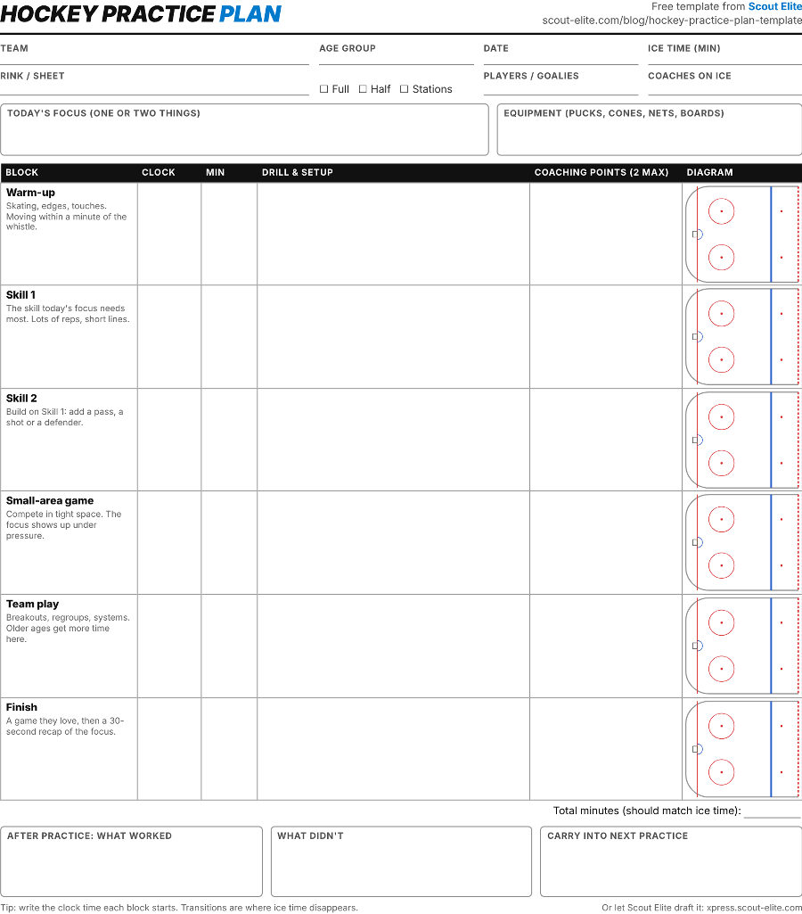
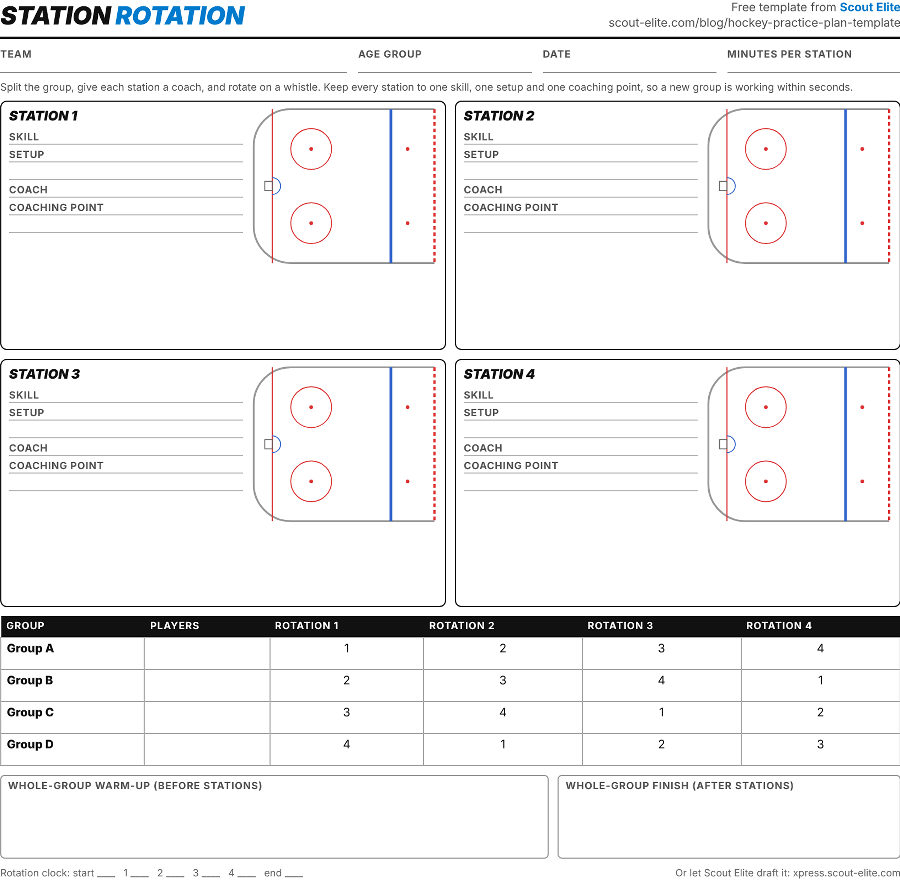
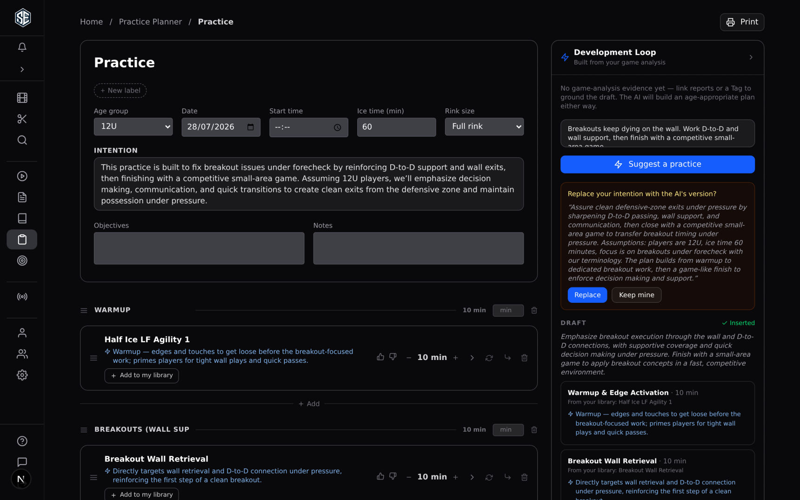

Every coach has the same Tuesday night: practice is tomorrow, the ice is booked for an hour, and the plan lives on the back of an envelope. This post gives you two printable sheets for that night, sample plans for 8U through 14U, and the research behind how they are laid out. It's free, with no email asked.

  <a href="/downloads/hockey-practice-plan-template.pdf" class="btn btn-primary" style="font-size:1.15em;padding:0.7em 2em;" download>Download the free template (PDF) &darr;</a>
  
Two pages, US Letter, prints cleanly in black and white.

## What's in the Template

**Page 1, the timed plan.** Team, age group, date, ice time and rink (full ice, half ice or stations) across the top. Then a box for today's focus, six timed blocks with a drill, two coaching points and a half-rink diagram each, a running total that should match your ice time, and three boxes for after practice: what worked, what didn't, and what carries into next time.

{: style="max-width:640px; width:100%; display:block; margin:1.5em auto; border:1px solid var(--border-color); border-radius:6px;" }

**Page 2, the station rotation.** Four stations, each with a skill, setup, coach, coaching point and a diagram, plus a rotation grid so four groups each hit every station once. There's a box for the whole-group warm-up before the stations and the whole-group finish after.

{: style="max-width:640px; width:100%; display:block; margin:1.5em auto; border:1px solid var(--border-color); border-radius:6px;" }

## Why It's Built This Way

I didn't invent the fields. Hockey Canada certifies its Development 1 coaches partly on the practice plan itself, using a written checklist: the [Development 1 Coach Evaluation Criteria](https://cdn.hockeycanada.ca/hockey-canada/Hockey-Programs/Coaching/Downloads/2018/dev1-coach-evaluation-criteria-e.pdf).<a href="#source-1">[1]</a> A plan meets it when it:

- Names a goal, or a few key elements to work on
- Records the date, time, location, and the number and level of players
- Splits the session into an introduction, warm-up, main part, cool-down and conclusion
- Puts the whole practice and each segment on a timeline, with durations
- Lists the teaching points that tie back to that goal

Every one of those has a place on page 1. The **one or two things** limit on the focus box comes from USA Hockey's 12U Practice Planner: "Instead of a random collection of drills or games, practices should be developed with a common theme so that the focus is on improving one or two particular aspects of play."<a href="#source-2">[2]</a> The **two coaching points** cap is mine. Kids can carry two cues from the bench to the ice. Five get lost.

The **clock column** is there because transitions are where an hour of ice quietly becomes 45 minutes of hockey. Write the time each block starts, and you'll see where it goes.

## Why Stations and Small-Area Games

Page 2 exists because the evidence for small spaces and many repetitions is consistent across both national federations and the independent research.

**Games give each player very little puck time.** USA Hockey's 8U parent guide reports that "In a 60-minute hockey game between 6- to 8-year-old children, the average player had possession of the puck for 20.7 seconds," and that the youngest players "would require 180 games" to get 60 minutes of puck possession.<a href="#source-3">[3]</a> The guide credits the original work to George Kingston in 1976, replicated in a 2002 USA Hockey study. I couldn't find either study published, so treat the exact figures as USA Hockey's report rather than peer-reviewed data. The direction of the finding is backed up below.

**Smaller areas mean more touches and more shots.** In 2019-20 the Finnish and Swedish ice hockey associations tracked U8 to U14 players across game formats from an eighth of the ice up to full ice, with "Tracking chips ... placed inside the jerseys."<a href="#source-4">[4]</a> Their conclusion: "5v5 on full ice appears to be the most inefficient way if you want to optimize technical repetition," and "small area games may create about 5-8 times more shooting attempts in one shift for a single player." On full ice, "The players skate more but that skating tends to be more passive, without any puck touches." Hockey Canada's cross-ice materials report the same pattern for small-area play: "Individual Puck Touches – 2 x Greater," "Shots per player – 6 x greater," "Pass Receptions – 5 x Greater."<a href="#source-5">[5]</a> USA Hockey published a similar comparison from an NHL analytics team's tracking of 8U players in 2017, though without a published method.<a href="#source-6">[6]</a>

**A good practice is more active than a game.** A peer-reviewed study fitted 17 nine- and ten-year-olds with accelerometers for one practice and one game. They spent "43.1% of their 70-min ice hockey practice" in moderate or harder activity, against "28.2% of their 80-min ice hockey game."<a href="#source-7">[7]</a> The sample is small (one team, one practice, one game), but it lines up with everything above: well-run practice is where the work gets done.

That's why both federations put the ratio firmly on the practice side, and why page 2 splits the ice so every kid is busy.

## Sample Hockey Practice Plans by Age (8U to 14U)

Each plan below follows the structure of USA Hockey's own published sample practices, so you can see the shape before filling in your own drills. Session lengths and season targets come from USA Hockey's American Development Model (ADM).

| | 8U | 10U | 12U | 14U |
|---|---|---|---|---|
| Ice session | 50 min<a href="#source-8">[8]</a> | 60 min<a href="#source-9">[9]</a> | 60+ min<a href="#source-9">[9]</a> | 80 min<a href="#source-10">[10]</a> |
| Practices : games per season | 34 to 40 practices, 16 to 20 cross-ice or half-ice games<a href="#source-8">[8]</a> | 75 to 80 : 20 to 25<a href="#source-9">[9]</a> | 80 to 90 : 30 to 35<a href="#source-9">[9]</a> | 120 to 130 : 40 to 50<a href="#source-11">[11]</a> |
| Hockey Canada time on skills vs tactics (same age band) | 75% skills at U9<a href="#source-12">[12]</a> | 50% technical skills, 20% individual tactics (Atom)<a href="#source-13">[13]</a> | 45% technical, 25% individual tactics (Peewee)<a href="#source-13">[13]</a> | 40% technical, 15% individual tactics (Bantam)<a href="#source-13">[13]</a> |

Two notes on the table. USA Hockey's 10U guide says plainly, "There should be a 3-to-1 practice-to-game ratio,"<a href="#source-9">[9]</a> while its 10U and 12U planners say "at least 2.5 practices to every one game."<a href="#source-2">[2]</a><a href="#source-14">[14]</a> Either way, games are the smaller number. Hockey Canada names its age groups differently (U9, U11, U13 and U15, still often called Atom, Peewee and Bantam above U9), so the last row puts each of its recommendations beside the closest US age group. Read it as guidance for the same stage of development, not a one-to-one match.

### 8U (U9) Practice Plan: six zones, everyone moving

USA Hockey's 8U guide describes the practice in one line: "Split the ice into 6 zones, with a different drill happening at each one. After 7–8 minutes, players switch zones until they have played in all 6."<a href="#source-3">[3]</a> Its 8U Practice Planner turns that into a sample session for 36 to 48 players:<a href="#source-15">[15]</a>

- **Free puck time (5 min):** "Dump as many items as possible onto the ice and let players play."
- **Six rotating stations (8 min each):** ball tag, skating, musical tires, a "mosh pit" team race, an obstacle course, and a 2v2 game.

That sample runs on a 60-minute slot. On a 50-minute ADM session, drop to 7 minutes a station, the 7 to 8 minutes the parent guide describes. On the template, use page 2 and add two stations in the margin, or run two groups of three.

### 10U (U11) Practice Plan: warm-up, four stations, a game

USA Hockey's 10U planner lists its practice design principles as "FUN/Engaging, Looks like the game, Constant decision making, Lots of puck touches, Challenging," and says "The majority of your practice time at 10U should be spent on development of skills."<a href="#source-14">[14]</a> Its first sample practice is exactly 60 minutes:

- **Warm-up (10 min)**
- **Station 1 (10 min):** net tag
- **Station 2 (10 min):** puck control
- **Station 3 (10 min):** musical cones
- **Station 4 (10 min):** wrist shots
- **Game (10 min)**

### 12U (U13) Practice Plan: same frame, more decisions

The 12U sample keeps the frame and makes the stations competitive:<a href="#source-2">[2]</a>

- **Keep-away (8 min)**
- **Four stations (10 min each):** 1v1 continuous, a gap control drill, 2v1 with a backchecker, 1v1 through a gate
- **Transition game (12 min)**

That's 60 minutes, and three of the four stations are small battles. USA Hockey's parent guide calls 12U "the golden age of skill development,"<a href="#source-9">[9]</a> so the stations should still be about the individual player, not the system.

### 14U (U15) Practice Plan: more team play, still mostly skills

At 14U the ADM moves to 80-minute sessions, but the planner is clear that "the majority of practice time should be spent on improving individual skills and understanding concepts."<a href="#source-10">[10]</a> Its early-season, 60-minute sample:

- **Free play (5 min)**
- **Gretzky game (10 min):** 3v3 with a support player below the goal line
- **Three stations (7 min each):** a shooting progression, 3v2 keep-away, a 1v1 angling drill
- **Down low (11 min)**
- **Net-front game (11 min)**

The listed blocks add up to 58 of the 60 minutes, which is about what transitions cost. Hockey Canada puts its own limit on the team side at this age: "time spent on team tactics and team play should not exceed 50-60% of the practice."<a href="#source-13">[13]</a>

## Filling It In: A 10-Minute Routine

This is the order I use after eight-plus years of AAA practices.

1. **Write the focus first.** One or two things, taken from the last game. "Win more puck battles on the wall" beats "compete."
2. **Fill the clock column before any drill.** Start at your ice time and work forward. If the minutes don't add up now, they won't on the ice.
3. **Pick the small-area game next.** It's where the focus gets tested under pressure, so choose it before the skill drills that build up to it.
4. **Build the skill blocks backward from the game.** Skill 1 is the bare skill, Skill 2 adds a pass, a shot or a defender.
5. **Two coaching points, max, per block.** Write the words you'll actually say.
6. **Fill in the after-practice boxes within an hour.** That's next week's focus, already written.

Stuck on a drill for a block? Scout Elite's  is free to browse with no account. Filter by category and age level, and most drills come with a rink diagram (some with video) you can copy onto the sheet.

## Or Let Scout Elite's Practice Planner Draft It

The template works. It also takes an evening once you're doing it twice a week for a whole season, which is why we built the practice planner in Scout Elite.

{: style="max-width:820px; width:100%; display:block; margin:1.5em auto; border-radius:8px;" }

You fill in the same things the template asks for (age group, date, ice time, full or half rink, and what you want this practice to fix), and the AI drafts a complete, timed plan in minutes. It pulls drills with rink diagrams from your drill library, explains why each drill is there, and keeps the blocks inside your ice time. If you'd rather start from a structure, pick one of the built-in frameworks: a balanced hour (skate, skills, systems, small-area games), a skill day, or a compete day.

The part the template can't do: the planner learns your team. Link your game reports and it builds Tuesday's practice from what went wrong on Saturday, and the more you use it, the better its drafts fit your players. When the plan is ready, print the one-page sheet for the clipboard or run it from your phone at the rink, block by block, with a timer.

The drafts don't come from a short stock list. The planner chooses from your own drills plus the community library: drills coaches have published, ranked by how other coaches rate them and how often they put them in their own plans. Swap any drill for another from either pool with a tap, and the block keeps its minutes.

You can try the planner in your browser with no signup, and  the same way. A free account creates up to three plans and ten of your own drills, with diagrams.



## Sources

1. {: #source-1} Hockey Canada and the Coaching Association of Canada, *Development 1 Coach Evaluation Criteria*, version 1.0, 2019. [PDF](https://cdn.hockeycanada.ca/hockey-canada/Hockey-Programs/Coaching/Downloads/2018/dev1-coach-evaluation-criteria-e.pdf)
2. {: #source-2} USA Hockey, *12-and-Under Practice Planner*, 2020. [PDF](https://cdn1.sportngin.com/attachments/document/1f47-3401796/12U_Practice_Planner_2020_FINAL.pdf)
3. {: #source-3} USA Hockey, *ADM 8U Parent Guide*, pp. 4-5. [PDF](https://portal.usahockey.com/cx/vice-president/hockey-development/8u_parent_guide.pdf)
4. {: #source-4} Lundby, J. and Väliaho, J., *Game Formats for Youth Hockey: Research by Finnish and Swedish Ice Hockey Association 2019-2020*, IIHF Growing the Game Fund, 2020. [PDF](https://blob.iihf.com/iihf-media/iihfmvc/media/downloads/sport%20files/development-guide/player-development-guide/sag-study-fihaandsiha_growingthegame_2020_6_17.pdf)
5. {: #source-5} Hockey Canada, *Small Area Games and Cross Ice Hockey*, 2020. [PDF](https://cdn.hockeycanada.ca/hockey-canada/Hockey-Programs/Players/Downloads/2020/small-area-games-cross-ice-e.pdf)
6. {: #source-6} USA Hockey, "Video Quantifies Cross-Ice Advantages," May 30, 2017. [Article](https://www.usahockey.com/news_article/show/472676-video-quantifies-cross-ice-advantages)
7. {: #source-7} van den Berg, C. and Kolen, A. M., "Children in Organized Hockey: How Much Physical Activity Do They Really Get?" *International Journal of Exercise Science* 8(2): 184-191, 2015. [Article](https://digitalcommons.wku.edu/ijes/vol8/iss2/9)
8. {: #source-8} USA Hockey, *Recommended Youth Hockey Program Structure by Age Group*. [PDF](https://portal.usahockey.com/cx/president/hockey-devlopment/recommended_youth_hockey_program_structure.pdf)
9. {: #source-9} USA Hockey, *ADM 10U and 12U Parent Guide*. [PDF](https://portal.usahockey.com/cx/president/hockey-devlopment/10-12u_parent_guide.pdf)
10. {: #source-10} USA Hockey, *14-and-Under Practice Planner*, 2019. [PDF](https://cdn1.sportngin.com/attachments/document/02cd-3401802/14U_Practice_Planner_2019_FINAL.pdf)
11. {: #source-11} USA Hockey, *ADM 14U and 16U Parent Guide*. [PDF](https://portal.usahockey.com/cx/president/hockey-devlopment/14-16u_parent_guide.pdf)
12. {: #source-12} Hockey Canada, "Under 9 Coaches: Skills." [Page](https://video.hockeycanada.ca/en-ca/hockey-programs/coaching/under-9/coaches/skills)
13. {: #source-13} Hockey Canada, *Skills Development Program: Player Development Pyramid*. [PDF](https://cdn.hockeycanada.ca/hockey-canada/Hockey-Programs/Players/Downloads/player_dev_LTPD_e.pdf)
14. {: #source-14} USA Hockey, *10-and-Under Practice Planner*, 2019. [PDF](https://cdn1.sportngin.com/attachments/document/6389-3401797/10U_Practice_Planner_2019_FINAL.pdf)
15. {: #source-15} USA Hockey, *8-and-Under Practice Planner*, 2019. [PDF](https://cdn1.sportngin.com/attachments/document/f615-3401794/8U_Practice_Planner_2019_FINAL.pdf)
